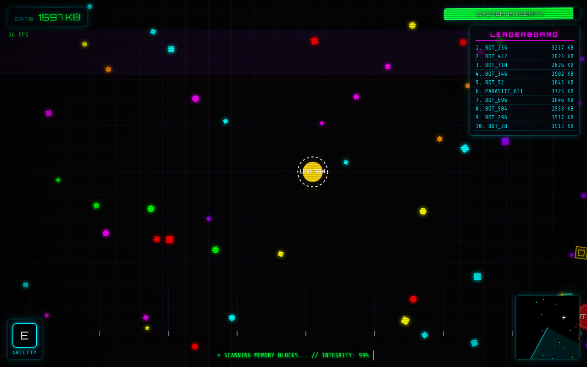
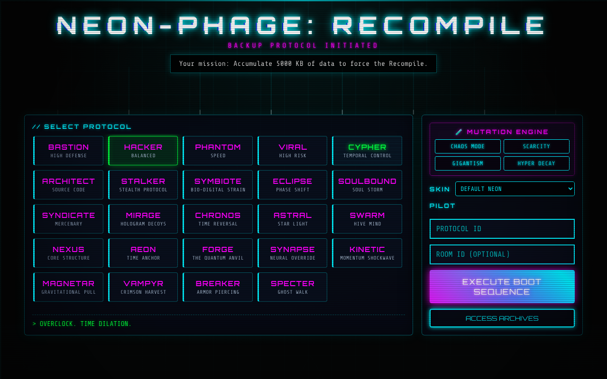
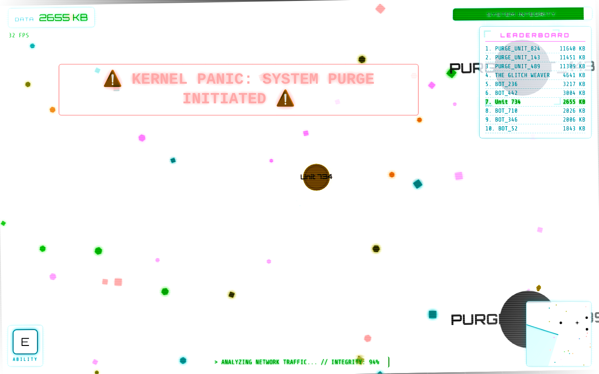
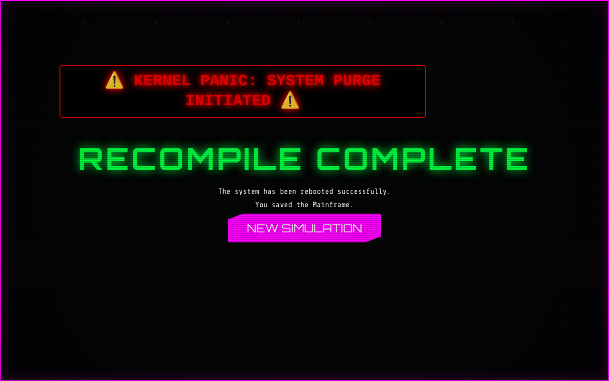
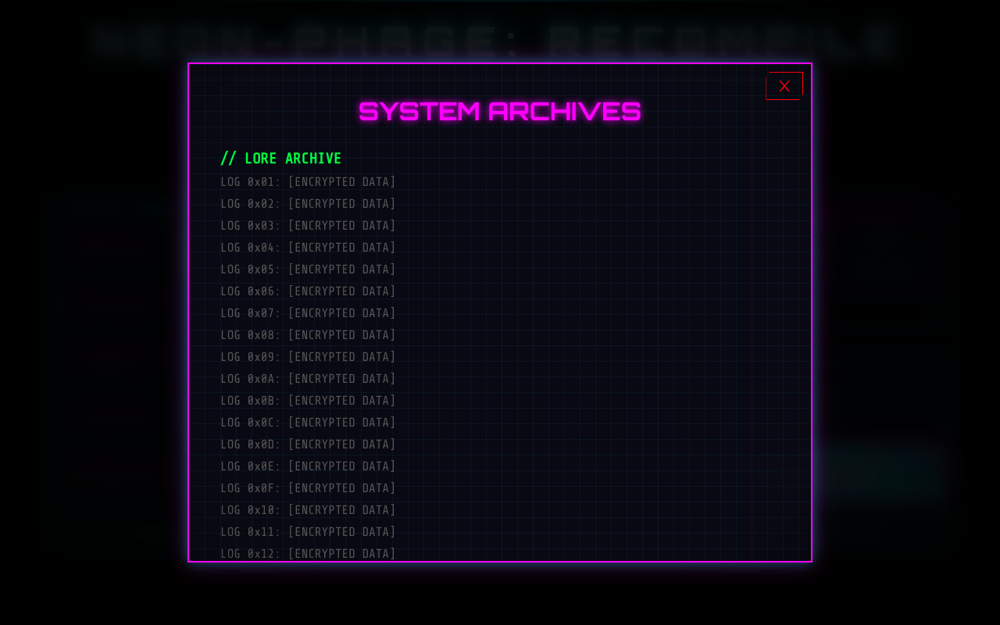
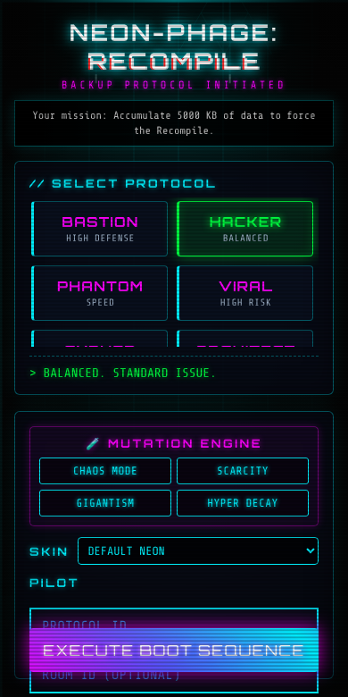
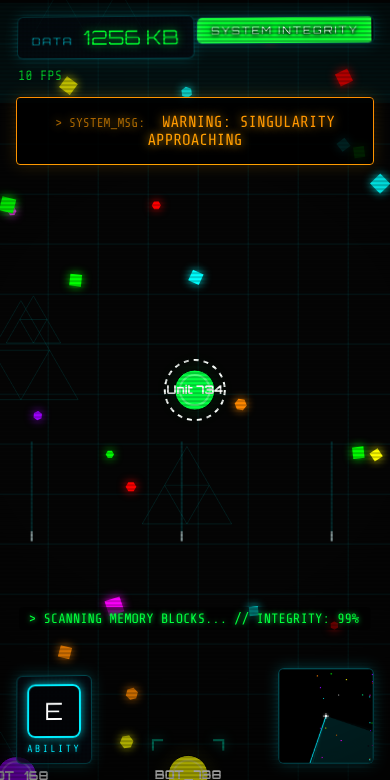

<div align="center">

# 💻 Kernel.io - Antivirus vs. PC Virus

**A macroscopic "Antivirus vs. PC Virus" digital ecosystem, built as a high-performance Agar.io clone.**<br/>
Play in the browser, no install: pick a protocol, eat data packets, survive the System Purge and reach 5000 KB.

[](https://argocd.antonio-code.duckdns.org)

<br/>



[Description](#-description) | [Screenshots](#-screenshots) | [Controls](#-controls) | [How it works](#-how-it-works) | [How to Play Locally](#-how-to-play-locally) | [Configuration](#-configuration) | [Develop](#-develop) | [Known limitations](#-known-limitations) | [Documentation](#-documentation) | [Deployment](#-deployment)

</div>

## 📝 Description

**Kernel.io** is an experimental game inspired by the "agar.io" genre, where you control an antivirus or PC virus entity in a host system's memory. The goal is to consume data packets and processes, evolve, and survive against other digital entities and system hazards.

## 📸 Screenshots

| Start screen | Gameplay |
| :---: | :---: |
|  |  |

| System Purge event | Win screen |
| :---: | :---: |
|  |  |

| System archives | Mobile start | Mobile gameplay |
| :---: | :---: | :---: |
|  |  |  |

> Regenerate them with `python3 -m http.server 8000` and `python3 screenshots.py` (needs `pip install playwright`).

## 🎮 Controls

| Input | Action |
| --- | --- |
| Mouse / touch joystick | Move |
| `SPACE` / DASH button | Dash (ejects mass for a speed boost) |
| `E` / right click | Protocol ability |
| Mouse wheel | Tactical zoom |

Reach **5000 KB** of data to force the Recompile and win. Beware of the System Purge at 2500 KB.

## 🧩 How it works

```mermaid
flowchart LR
    main["js/main.js<br/>BootSequence"] --> game["js/game.js<br/>Game loop"]
    main --> input["js/input.js<br/>InputHandler"]
    main --> ui["js/ui.js<br/>UIManager"]
    game --> systems["js/game_systems.js<br/>purge, singularity, boss, raid, rift"]
    game --> entities["player.js, bot.js, food.js"]
    game --> collisions["js/core/game_collisions.js<br/>SpatialHash"]
    game --> renderer["js/renderer.js<br/>Canvas 2D"]
    game --> network["js/network_system.js"]
    network -. Socket.io .-> server["server.js<br/>room relay"]
```

The game is plain ES modules served as static files: `index.html` loads `js/main.js`, which wires input, renderer and UI into `Game`. Each frame `Game.update()` advances the player, bots, world events and collisions (broad phase through a spatial hash), then the renderer draws the canvas. Multiplayer is optional: `NetworkSystem` joins a room on `server.js`, which only relays positions between sockets.

## 🛠️ Tech Stack

- **Frontend**: HTML5 Canvas, JavaScript (Vanilla ES modules)
- **Multiplayer relay**: Node.js, Express, Socket.io (`server.js`)
- **Tests and lint**: Vitest, jsdom, ESLint, Prettier
- **Styling**: CSS3
- **Game Logic**: Custom particle engine, macroscopic collision systems.
- **Automation**: Python scripts for verifying bot behaviors and zone rules.

## 🚀 How to Play Locally

1. Clone the repository:
   ```bash
   git clone https://github.com/juninmd/agar.git
   ```
2. Run a local web server (e.g., `python3 -m http.server 8000`)
3. Open `http://localhost:8000` in your browser (add `?skipBoot` to skip the boot sequence).

Run the unit tests and linter with `pnpm install && pnpm test --run && pnpm exec eslint js`.

## 🔧 Configuration

| Name | Purpose | Required / default | Example |
| --- | --- | --- | --- |
| `?skipBoot` (URL query) | Skips the boot sequence | Optional, off | `http://localhost:8000/?skipBoot` |
| `PORT` (env, `server.js`) | Port of the multiplayer relay | Optional, `3000` | `PORT=3000 node server.js` |

## 🧰 Develop

```bash
pnpm install                       # install dev dependencies (Vitest, ESLint, jsdom, Express, Socket.io)
pnpm test --run                    # run the 15 Vitest suites once
pnpm exec eslint js                # lint the game code
python3 -m http.server 8000        # serve the static game at http://localhost:8000
node server.js                     # start the multiplayer relay on PORT (default 3000)
python3 screenshots.py             # regenerate docs/images (needs the server above and playwright)
python3 verification/verify_game.py  # Playwright smoke check used by CI (needs the server above)
```

## 🚧 Known limitations

- The multiplayer client connects to the hard-coded `http://localhost:3000` (`js/network_system.js`), and the relay only forwards positions: there is no server-side game state or validation, and CORS is open (`origin: "*"`).
- Without `server.js` running, the game plays single-player against bots.
- `pnpm-lock.yaml` is git-ignored, so installs are not pinned to a lockfile.

## 📚 Documentation

| File | Contents |
| --- | --- |
| [ROADMAP.md](ROADMAP.md) | Development phases and what is done |
| [LORE.md](LORE.md) | Narrative behind the Recompile Protocol |
| [CONTRIBUTING.md](CONTRIBUTING.md) | Development process and code style |
| [AGENTS.md](AGENTS.md) | AI personas used in development |

## 📦 Deployment

This project is served via **Nginx** on a **K3s** cluster.

- **Production URL**: [https://agar.antonio-code.duckdns.org](https://agar.antonio-code.duckdns.org)
